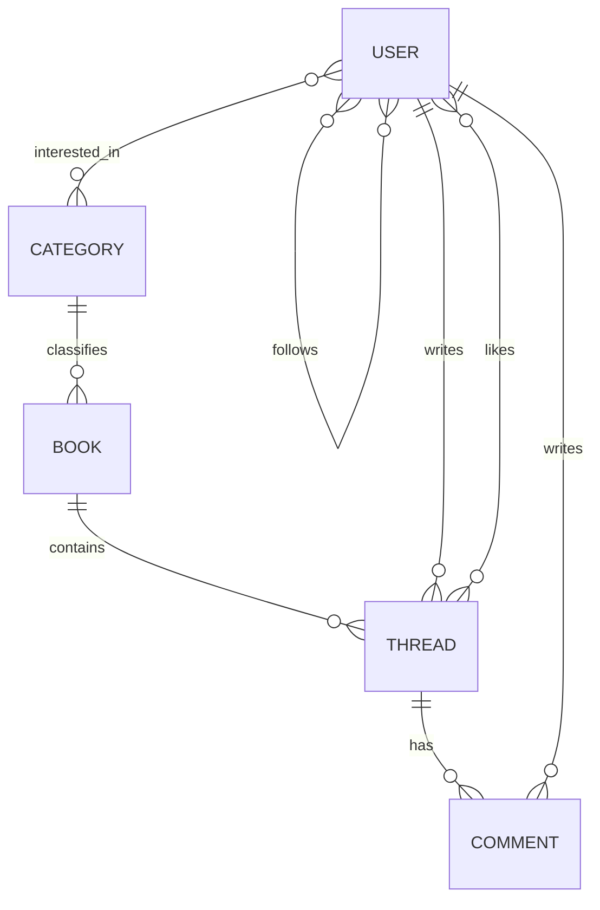
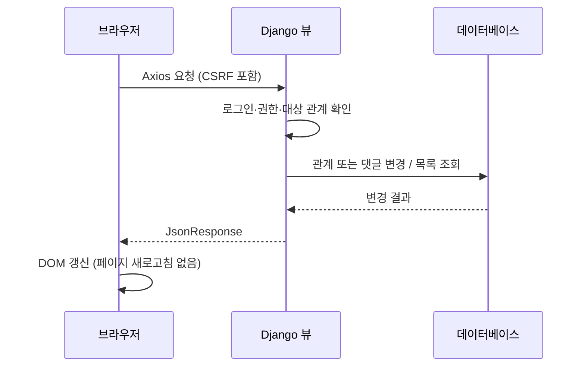

# ThRead — AI 기반 도서 분석과 독서 기록 서비스

## 1. 프로젝트 소개

ThRead는 도서 정보를 살펴보고, 독서 기록과 댓글을 작성하며, 다른 독자와 관심사를 나누는 온라인 서재 서비스입니다.

## 2. 프로젝트 목표

- Axios와 Django `JsonResponse`를 이용한 비동기 요청·응답 흐름을 익힙니다.
- Django의 N:1 및 N:M 관계를 활용해 도서, 독서 기록, 사용자 관계를 구현합니다.
- AI 임베딩 유사도를 활용한 도서 추천과 API 실패 시 대체 동작을 구현합니다.

## 3. 개발 환경 및 기술 스택

| 구분 | 기술 |
| --- | --- |
| 언어 | Python 3.11 기준 |
| 서버 | Django 5.2 |
| 화면 | HTML5, CSS3, Django Template Language |
| UI | Bootstrap 5.3, Bootstrap Icons |
| 비동기 통신 | Vanilla JavaScript, Axios |
| 데이터베이스 | SQLite |
| AI 임베딩 | SSAFY GMS의 OpenAI 호환 Embeddings API (`text-embedding-3-small`) |

현재 이 작업 환경의 검증 런타임은 Python 3.12.7, Django 5.2.19입니다. 재현 환경은 `requirements.txt`와 Python 3.11을 기준으로 구성합니다.

## 4. 팀원 및 역할 분담

실제 팀원 정보는 전달되지 않아 임의로 작성하지 않았습니다.

| 팀원 | 담당 역할 |
| --- | --- |
| [직접 입력] | [직접 입력] |
| [직접 입력] | [직접 입력] |

## 5. 프로젝트 디렉터리 구조

```text
skeleton/
├─ accounts/                 # 사용자 모델, 인증, 프로필, 팔로우
│  ├─ migrations/
│  └─ templates/accounts/
├─ books/                    # 도서, 쓰레드, 댓글, 추천, 비동기 API
│  ├─ fixtures/              # categories.json, books.json
│  ├─ migrations/
│  └─ templates/books/
├─ mypjt/                    # Django 설정 및 루트 URL
├─ templates/base.html        # 공통 레이아웃과 디자인
├─ manage.py
├─ requirements.txt
└─ README.md
```

## 6. 요구사항 명세

| ID | 요구사항 | 구현 상태 |
| --- | --- | --- |
| F1001 | 프로필 팔로우 및 언팔로우 | 완료 |
| F1002 | 쓰레드 좋아요 및 취소 | 완료 |
| F1003 | 댓글 비동기 작성 및 작성자 삭제 | 완료 |
| F1004 | 도서 장르 비동기 필터링 | 완료 |
| F1005 | 임베딩 기반 도서 추천 및 대체 추천 | 완료 |
| NF1001 | Git 협업 규칙 정리 | README에 제안으로 기록, 팀 합의 필요 |

## 7. 주요 기능

- **팔로우:** 로그인 사용자만 다른 사용자를 팔로우할 수 있습니다. 자기 자신 팔로우는 거부합니다.
- **좋아요:** 로그인 사용자의 좋아요를 N:M 관계로 저장하고 같은 사용자의 중복 레코드를 만들지 않습니다.
- **댓글:** 로그인 사용자만 작성할 수 있으며, 작성자 본인만 삭제할 수 있습니다. 새 댓글과 삭제 결과를 페이지 갱신 없이 반영합니다.
- **장르 필터:** 로그인 여부와 관계없이 장르별 도서를 조회하며, 한 번에 24권씩 보여 주고 `더 보기`로 이어서 불러옵니다. 응답이 늦은 이전 요청은 취소·식별합니다.
- **도서 추천:** GMS 임베딩 응답을 코사인 유사도로 정렬해 현재 도서를 제외한 최대 3권을 보여줍니다. API를 사용할 수 없으면 UI에 `카테고리 기반 추천`이라고 명확히 표시합니다.
- **오류 처리:** 비로그인, 존재하지 않는 대상, URL의 도서·쓰레드 불일치, 빈 댓글, 권한 없는 댓글 삭제를 서버에서 확인합니다.

## 8. 데이터베이스 관계 및 ERD



`Book.category`는 N:1, `Thread.book`과 `Thread.user`는 각각 N:1입니다. `Thread.likes`, `User.followings`, `User.interested_genres`는 N:M 관계입니다. 댓글은 쓰레드 및 사용자에 각각 N:1로 연결됩니다.

## 9. AJAX와 Axios 비동기 통신

모든 변경 요청은 Axios POST로 전송하고 CSRF 토큰을 `X-CSRFToken` 헤더에 담습니다. Django 뷰는 권한과 대상 관계를 다시 확인한 후 JSON을 반환합니다. 화면에는 사용자 입력을 HTML 문자열로 삽입하지 않고 DOM의 `textContent`로 표시합니다.



주요 URL은 `accounts/<user_pk>/follow/`, `books/<book_pk>/thread/<thread_pk>/likes/`, `books/<book_pk>/comment/<thread_pk>/create/`, `books/<book_pk>/comment/<comment_pk>/delete/`, `books/filter-category/`입니다.

## 10. Git 브랜치 전략

아래 전략은 팀 논의를 위한 제안입니다. 현재 브랜치를 확인하고 팀 합의 없이 새 브랜치를 만들거나 병합하지 않습니다.

- `main` 또는 `master`: 제출 가능한 안정 상태
- `develop`: 기능 통합
- `feature/<기능>`: 기능별 작업

## 11. 브랜치별 역할

| 브랜치 예시 | 역할 |
| --- | --- |
| `main` 또는 `master` | 최종 제출 버전 |
| `develop` | 기능 통합 및 확인 |
| `feature/follow` | 팔로우 |
| `feature/likes` | 좋아요 |
| `feature/comments` | 댓글 |
| `feature/category-filter` | 장르 필터 |
| `feature/recommendation` | 도서 추천 |
| `feature/design` | 화면 디자인 |

실제 브랜치와 담당자는 팀에서 정합니다.

## 12. 커밋 메시지 규칙

- `feat`: 기능 추가
- `fix`: 오류 수정
- `style`: 화면 및 CSS 수정
- `refactor`: 구조 개선
- `docs`: 문서 수정
- `chore`: 환경 설정

예시: `feat: 쓰레드 좋아요 비동기 처리`

## 13. GitLab 커밋 내역 스크린샷

실제 GitLab 화면 캡처를 여기에 첨부합니다.

> [GitLab 커밋 내역 스크린샷 첨부]

## 14. 기능별 실행 결과 스크린샷

실제 실행 화면을 확인한 뒤 캡처를 첨부합니다. 아직 첨부되지 않은 화면을 완료 증거로 간주하지 않습니다.

| 기능 | 스크린샷 |
| --- | --- |
| 도서 목록 및 장르 필터 | [스크린샷 첨부] |
| 도서 상세 및 추천 | [스크린샷 첨부] |
| 쓰레드 좋아요 및 댓글 | [스크린샷 첨부] |
| 프로필 및 팔로우 | [스크린샷 첨부] |

## 15. AI 도서 추천 알고리즘

1. 현재 도서 외의 책을 대상으로 장르와 제목·작가·소개 글의 단어 겹침을 이용해 최대 40권의 후보를 고릅니다.
2. 현재 책과 후보 책의 제목, 작가, 장르, 소개 일부를 한 번의 GMS 임베딩 요청으로 벡터화합니다.
3. 코사인 유사도를 계산해 점수가 높은 최대 3권을 추천합니다.
4. 현재 책의 내용 서명이 같은 결과는 24시간 캐시합니다. 임베딩 요청 실패 결과는 5분간 카테고리 기반으로 캐시합니다.
5. GMS 키 또는 URL이 없거나 API 요청이 실패하면 같은 장르의 다른 책을 보여 주고, 화면에 `카테고리 기반 추천`으로 구분합니다.

키는 `.env`의 `GMS_KEY`, `GMS_URL`에서 읽습니다. 키를 소스 코드나 README에 기록하지 않습니다. 이미지 생성에는 기존 코드가 `GMS_IMG_URL`도 사용합니다. 자동 테스트는 API를 호출하지 않고 요청 응답을 모의 처리합니다.

## 16. 트러블슈팅

| 증상 | 원인 및 대응 |
| --- | --- |
| `google.genai` import 실패 | 이미지 생성 SDK가 설치되지 않은 환경에서도 앱을 열 수 있게 실제 이미지 생성 요청 때 SDK를 import합니다. 이미지 생성은 건너뛰고 쓰레드 등록은 계속됩니다. 전체 의존성은 `requirements.txt`에서 설치합니다. |
| AI 추천 요청 실패 | 키·URL 또는 외부 서비스 문제일 수 있습니다. 페이지는 카테고리 기반 추천으로 동작하며, 실제 API 키는 화면·로그에 출력하지 않습니다. |
| SQLite DB가 비어 있음 | 마이그레이션 적용 후 fixture를 최초 한 번만 적재합니다. 이미 데이터가 있으면 fixture를 무조건 다시 로드하지 않습니다. |
| 테스트에서 API가 호출될 우려 | 임베딩 응답을 모의 처리해 실제 GMS 요청 없이 추천 순위와 대체 경로를 확인합니다. |

## 17. 학습한 내용

[직접 작성: Django 인증과 권한, N:1·N:M 관계, Axios와 JSON 응답, CSRF 처리 등]

## 18. 프로젝트를 진행하며 느낀 점

[팀에서 실제로 경험한 내용으로 직접 작성]

## 19. 프로젝트 실행 방법

Python 3.11 환경을 준비한 뒤 `skeleton` 디렉터리에서 실행합니다.

```powershell
python -m venv .venv
.\.venv\Scripts\Activate.ps1
python -m pip install -r requirements.txt
if (-not (Test-Path .env)) { Copy-Item .env.sample .env }
# .env에 발급받은 GMS_KEY, GMS_URL을 입력합니다.
python manage.py migrate
python manage.py loaddata categories books  # 새 DB에 최초 1회만 실행
python manage.py runserver
```

이미 DB에 데이터가 있으면 `loaddata` 전에 상태를 확인합니다. `.env`는 Git에 커밋하지 않습니다.

검증 명령:

```powershell
python manage.py check
python manage.py test
```

## 20. 요구사항별 구현 완료 여부

| 요구사항 | 상태 | 검증 |
| --- | --- | --- |
| F1001 팔로우 | 완료 | 인증, 자기 자신 차단, 토글, CSRF 테스트 |
| F1002 좋아요 | 완료 | 토글, 로그인, URL 관계 확인 테스트 |
| F1003 댓글 CRUD | 완료 | 빈 댓글, 작성자 권한, CSRF, URL 관계 테스트 |
| F1004 장르 필터 | 완료 | 공개 조회, 전체·장르·빈 결과 테스트 |
| F1005 도서 추천 | 완료 | 임베딩 정렬·캐시·API 실패 대체 테스트 |
| UI/UX 개선 | 완료 | Django 템플릿 렌더링 및 전체 테스트로 확인 |

실제 GMS 서비스 호출 결과, 팀 역할, GitLab 캡처, 학습 소감은 이 문서에서 임의로 작성하지 않았습니다.
